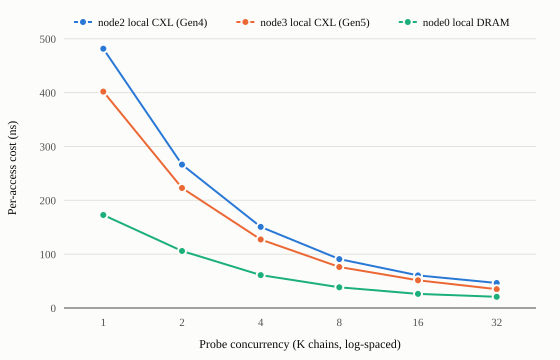
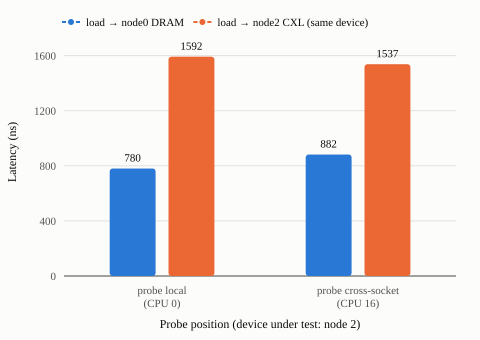

# Silent Link Degradation in CXL Memory: Idle-Latency Evaluation Misstates Its Cost

*Draft v1 — 2026-11-17. Target: ICPE (ACM SIGMETRICS).*

---

## Abstract

CXL memory devices are routinely evaluated with idle-latency microbenchmarks,
and link-width and link-speed decisions are justified with the resulting
numbers. On a dual-socket Granite Rapids server we found two CXL memory devices
of identical model, identical firmware, and adjacent serial numbers whose PCIe
links trained at different speeds: 16 GT/s (Gen4) and 32 GT/s (Gen5). Both
endpoints advertise 32 GT/s capability, the operating system requests 32 GT/s
(`Target Link Speed`), and no AER error is recorded on either link. The
degradation is invisible to error counters, though it is visible if one compares
negotiated speed against advertised capability.

We measure both devices with a dependency-chain probe at controlled concurrency.
At zero load the slower device costs 18.5% more per access. The gap grows
monotonically once competing traffic is applied, reaching 82.9% at eight load
threads and 125.7% at sixteen — measured on two probe configurations, whose
curves agree to within 1–5 percentage points up to eight load threads. A single
competing thread is already enough to double the idle gap.

We define cost three ways and report all three, because they disagree by 6×.
Ratio of gaps: 4.5× at eight threads, 6.2× at sixteen. Ratio of absolute
per-access penalties: 9.8×. Ratio of latency ratios: 1.54×. Which one is
"the" cost depends on what the deployment optimises, and we state that
explicitly rather than picking the largest.

We also report five measurement pitfalls that each inverted a conclusion before
being corrected, and a control experiment showing that the two sockets are
equivalent for local DRAM access (−0.8 ns), so the device gap is not a socket
artefact.

---

## 1. Introduction

A CXL memory device is a memory tier without cores of its own. This makes the
usual notion of locality ambiguous: a device can be *link-local* (attached to
the same socket) while being *compute-remote* (no core resides there). It also
makes link configuration unusually consequential, because every access to the
device traverses that link and nothing else amortises it.

Practitioners deciding how much to spend on link width and link speed rely on
characterisation studies and on vendor tooling. The de facto standard tool,
Intel MLC, reports latency under `--idle_latency` — a single dependency chain,
no competing load. Many published CXL characterisations do the same.

This paper asks a narrow question: **does idle latency predict what a link
configuration will cost once the system is busy?**

Our answer came from an accident of the platform rather than a designed
experiment. Two CXL devices in the same machine negotiated different link
speeds. Everything else about them is the same: model, firmware revision,
serial-number range, driver, NUMA arrangement. That gives us a controlled
comparison we did not have to construct.

Contributions:

1. **A silent degradation in the wild (§2.3).** One of two otherwise identical
   CXL devices trains at Gen4 while the system requests Gen5. Capability is
   advertised, the target rate is set, and zero correctable errors are logged.
   No error counter or health check reveals it; only comparing negotiated speed
   against advertised capability does.

2. **The cost is load-dependent, and one competing thread is enough (§4.2).**
   Idle, the gap is 18.5%. A single load thread already doubles it, to 38.6%.
   At eight threads it is 82.9%; at sixteen, 125.7%. The magnitude of the
   effect depends on how "cost" is defined, and we report three definitions
   that differ by up to 6× (§4.2.1).

3. **An interference-domain decomposition, and its failure to generalise
   (§4.3).** Competing traffic on the *same device* costs more than moving the
   probe to another socket on node 2 (6.4–8.0×), but the ratio inverts on
   node 3 (0.7–1.5×). We report both and withdraw the general claim: the sign
   of the effect is robust, its magnitude is not.

4. **Socket asymmetry ruled out (§4.5).** A symmetric DRAM control across both
   sockets shows the two are equivalent for local access (−0.8 ns, −0.4%), so
   the measured device gap is not a socket artefact.

5. **A validated concurrency instrument (§3) and four pitfalls (§3.5).**
   Four measurement artefacts each inverted our conclusion before we found
   them. We document them with dose-response evidence, because the same
   artefacts are latent in any dependency-chain measurement.

---

## 2. Background and Platform

### 2.1 Test platform

| Component | Detail |
|---|---|
| CPU | 2 × Intel Xeon 6515P (Granite Rapids), 16 cores/socket, 32 cores / 64 threads, 2.3 GHz base |
| Caches | L1d 48 KiB/core, L2 2 MiB/core, L3 72 MiB/socket |
| OS | Ubuntu 22.04.5, Linux 6.8.0-138 |
| Tools | perf 6.8.12, Intel MLC 3.13, numactl |
| Memory | 64 GiB DRAM per socket (nodes 0, 1); 64 GiB CXL per socket (nodes 2, 3) |

Node 2 is CXL memory attached to socket 0; node 3 is CXL memory attached to
socket 1. CPU 0 is on socket 0, CPU 16 on socket 1.

### 2.2 The two devices

Both devices are the same part: PCI ID `1b00:c001` rev 01, firmware
`10.40.1.060f.00`, serials `…0a66` and `…090f`.

| | mem0 (node 2) | mem1 (node 3) |
|---|---|---|
| Upstream port | 0000:32:02.0 | 0000:b3:02.0 |
| Endpoint | 0000:33:00.0 | 0000:b4:00.0 |
| Negotiated link | **16 GT/s × 8** | 32 GT/s × 8 |
| Endpoint capability | 32 GT/s × 8 | 32 GT/s × 8 |
| Upstream port capability | 32 GT/s × 16 | 32 GT/s × 16 |

The devices are RAM-configured CXL.mem. Despite perf attributing samples to
"PMEM hit", these are volatile devices and we do not refer to them as
persistent memory anywhere in this paper.

### 2.3 The link degradation is silent

Four independent observations establish that mem0's Gen4 operation is a
training downgrade rather than a configured limit.

**(i) The hardware supports Gen5.**

```
LnkCap:  Port #0, Speed 32GT/s, Width x16
LnkCap2: Supported Link Speeds: 2.5-32GT/s, Retimer+ 2Retimers+ DRS-
```

**(ii) The system requests Gen5 and does not get it.**

```
LnkCtl2: Target Link Speed: 32GT/s, EnterCompliance- SpeedDis-
```

A BIOS-imposed limit would set `Target Link Speed` to 16 GT/s. It is 32.

**(iii) Both ends of the link are at Gen4.** The upstream port (32:02.0) and the
endpoint (33:00.0) both report 16 GT/s, so the downgrade affected the whole
link, not one endpoint.

**(iv) Nothing else in the machine is below its capability.** Scanning every
PCIe leaf device and excluding idle-state links (2.5 GT/s), exactly one device
in the system runs below its own advertised maximum:

```
BDF             class        current        own max
0000:33:00.0    CXL [0502]   16.0 GT/s      32.0 GT/s
```

RAID (16 GT/s), NIC (5 GT/s), and GPU (2.5 GT/s idle) all sit within their own
capability. The degradation is therefore not a socket-wide or platform-wide
policy.

**No errors are logged.** Every AER field on both endpoints and both upstream
ports reads zero: `RxErr`, `BadTLP`, `BadDLLP`, `Timeout`, and all fatal and
non-fatal categories. A standard health check sees a perfectly healthy link.

The path reports `Retimer+ 2Retimers+`, meaning two retimers sit between the
root port and the endpoint. Retimers are the most common failure point for Gen5
signal integrity, and the sibling link with the same retimer topology reaches
Gen5. Narrowing further requires board documentation that is not available to
us, and we do not claim a root cause beyond "training downgrade on a
retimer-equipped path".

### 2.4 Consequence for the rest of the paper

Because the two devices differ only in negotiated link speed, every comparison
between mem0 and mem1 isolates that variable. We never compare across machines,
and we never rely on absolute link-speed figures from a datasheet.

---

## 3. Measurement Methodology

### 3.1 Why dependency chains

To measure the latency of a *single* access we must prevent the hardware from
overlapping it with others. A dependent pointer chase does exactly that: each
load's address comes from the previous load's data, so the out-of-order engine
cannot run ahead. This is why dependency chains are the standard instrument for
memory latency.

The same property makes them unrepresentative. A chase sustains exactly one
outstanding load. A real memory-bound service sustains many. We therefore need
two instruments: one that measures single-access latency precisely, and one
that controls concurrency.

### 3.2 Instrument 1: cold single-chain probe (`chase`)

A random permutation over a region, walked once. Per-access TSC pairs bracket
each load. To keep the measurement free of cache reuse we size the ring far
beyond L3 (4 GiB) and sample fewer accesses than the ring holds, so no location
is revisited during measurement: `samples = 0.9 × nodes`.

`rdtscp` costs 21.25 cycles on this platform, measured by a back-to-back pair.
That cost is included in the reported latencies; it is ~9 ns at 2.3 GHz.

### 3.3 Instrument 2: interleaved multi-chain probe (`multichase`)

K independent chains are advanced in lockstep within one thread. Round *r+1*'s
load for a lane depends on round *r*'s store to that lane's cursor, so lanes are
serial across rounds but independent within a round. If the core issues all K
loads before any retires, in-flight loads equal K by construction.

Timing is per round, not per access. This is a deliberate compromise:
instrumenting each access with `rdtscp` inside the loop serialises the lanes
(we verified this: with per-access timing, K = 1…32 all produced ≈500 ns per
access and identical wall time, i.e. MLP collapsed to 1). Timing the round
costs one `rdtscp` per K accesses, so the overhead shrinks as K grows.

`multichase` reports `ns_per_access = mean_round_time / K`, which is a
**throughput** metric, not a latency. We treat it as such throughout.

### 3.4 Validating that K equals MLP

The claim "in-flight loads = K" needs independent evidence, and this machine
exposes no `l1d_pend_miss.pending` counter, so we cannot measure it directly.
We test it by a null hypothesis instead.

If K accesses are genuinely concurrent and suffer no contention, the round time
should equal the expected maximum of K independent draws from the single-access
latency distribution. We sample that distribution from instrument 1 and
compare.

For mem0 local, idle, three repetitions:

| K | r1 | r2 | r3 | mean |
|---:|---:|---:|---:|---:|
| 1 | 1.00× | 1.00× | 1.00× | 1.00× |
| 2 | 1.01× | 1.01× | 1.01× | 1.01× |
| 4 | 1.01× | 1.01× | 1.01× | 1.01× |
| 8 | 1.05× | 1.07× | 1.05× | 1.06× |
| 16 | 1.22× | 1.23× | 1.22× | 1.22× |
| 32 | 1.68× | 1.69× | 1.68× | 1.68× |

Ratios of 1.00–1.06× for K ≤ 8 mean the round completes as fast as the slowest
of K independent accesses would — no serialisation, no queueing. Concurrency is
real. Across all six paths the same holds (0.97–1.05× at K = 8).

From K = 16 the ratio exceeds unity, reaching 1.68× at K = 32. The excess is
not statistical: it means loads are being issued in batches because the core's
load queue is finite. We therefore treat **K ≤ 8 as the clean range**, report
K = 16 with the caveat, and never label K = 32 as MLP = 32.

This matters for honesty about scope: real services run at MLP 8–32, so we can
cleanly cover the lower half of that range and characterise the upper half only
through the batch behaviour.

### 3.5 Five pitfalls that inverted our conclusions

Each of these produced a qualitatively wrong result before correction. We
report them because they are latent in any dependency-chain study, and because
they are the reason the numbers in §4 can be trusted.

**(P1) MLC's `-r` is not full-buffer random.** MLC 3.13 randomises accesses
*within a block* of `-D` cache lines, exhausting one block before moving to the
next (readme, lines 523–532), and sets stride to 128 B. Lines already touched
inside a block are still resident, so later accesses hit cache. On our platform
12.06–12.76% of samples land in the 0–31 cycle bins — below the 21.25-cycle
`rdtscp` cost, and physically impossible for a cold CXL access. A `-D` sweep
confirms the mechanism:

| `-D` | block | sub-32 cycles |
|---:|---:|---:|
| 64 | 4 KiB | 58.02% |
| 1024 | 64 KiB | 41.45% |
| 4096 | 256 KiB | 16.46% |
| 16384 | 1 MiB | 7.71% |
| 32768 | 2 MiB | 3.95% |
| 131072 | 8 MiB | 0.71% |

The steepest drop is between 1 MiB and 2 MiB — the L2 capacity of this core.
The sub-32 population is block-internal reuse, it scales with cache capacity,
and it is unaffected by the prefetcher flag (`-e` is documented as *leaving
prefetchers as they are*, so it does not disable them). Reported means are
therefore low by 9–13%, and the effect is path-dependent (4.4% on local DRAM
versus 12–13% on CXL), which is exactly the kind of bias that distorts
cross-path comparison.

**(P2) `LLC-loads` counts page walks.** Our first attempt used
`LLC-loads`/`LLC-load-misses`. The resulting hit rate *rose* with working set
size (44.5% at 128 MiB, 69.7% at 512 MiB) — the opposite of what reuse
predicts. Intel counts page-walk requests in these events; larger working sets
mean more TLB misses, and page-table entries are themselves L3-resident.
Switching to `ocr.demand_data_rd.*` (offcore response, demand data reads only)
restored the expected monotonic fall: 99.5% at 32 MiB down to 8.4% at 512 MiB.
**A wrong event definition reversed the trend.**

**(P3) Ring reuse.** With a 256 MiB ring walked repeatedly, L3 (72 MiB) holds
roughly a quarter of it, so a quarter of "cold" accesses actually hit L3.
Against a genuine cold baseline (4 GiB ring, single pass, fast-mode fraction
0.00–0.04%) the earlier means are low: mem0 local reads 342.8 ns instead of
470.8 ns, i.e. **27.2% low**.

This is a separate bias from P1 and must not be added to it. The two compound
but are not additive: P1 (block-internal reuse inside MLC) affects MLC's
numbers, P3 (ring reuse in our own probe) affects ours.

**(P4) Mismatched load placement.** In our first loaded experiment the load
threads were pinned to CPUs 1–4 (socket 0) for every path. For node 3 that made
the load cross sockets, so its injection rate was far lower, and we measured a
spurious 150–240% speed gap. With the load placed on the same socket as the
device under test, and injection verified by the CXL PMU (device read counts
matched within 12–15%), the real gap is 60–83%. The original data set is
discarded and not used in this paper.

**(P5) Little's law on round times.** We initially estimated effective
concurrency as throughput × mean latency, and concluded the in-flight limit was
~10. That is invalid here: the round time is the maximum of K latencies, so
throughput × mean is necessarily below K. §3.4's null-hypothesis test is the
correct instrument; it shows the limit is 8 at K = 8 (ratio 1.06) and that the
shortfall at larger K is batching, not a cap near 10.

---

## 4. Evaluation

All cells: 4 GiB cold ring, 64 B stride, 3 repetitions, placement verified
via `/proc/self/numa_maps` (every cell reports zero off-node pages).

### 4.1 Idle: the link gap is modest



*Figure 1: Per-access cost versus probe concurrency K, no competing load, for
the two CXL devices and local DRAM. The Gen4/Gen5 gap is a consistent ~20%
across the whole range, and both CXL curves remain far above DRAM at every K.*

Single-access and multi-chain latency with no competing load (Figure 1):

| Path | K=1 | K=2 | K=4 | K=8 | K=16 | K=32 |
|---|---:|---:|---:|---:|---:|---:|
| node0 local DRAM | 172.7 | 105.8 | 61.1 | 38.4 | 26.3 | 20.8 |
| node1 cross DRAM | 568.7 | 321.5 | 185.7 | 110.2 | 71.9 | 56.6 |
| **node2 local CXL (Gen4)** | **481.6** | 266.2 | 150.5 | **90.8** | 60.5 | 46.3 |
| **node3 local CXL (Gen5)** | **401.9** | 222.8 | 127.2 | **76.1** | 51.5 | 34.8 |
| node2 cross CXL | 930.3 | 522.9 | 298.4 | 175.1 | 113.8 | 88.7 |
| node3 cross CXL | 910.2 | 510.8 | 289.3 | 167.4 | 112.3 | 88.1 |

The headline idle comparison is the same-socket pair, same CPU, only the link
differing: **481.6 versus 401.9 ns, a 19.8% gap at K = 1**, and 19.3% at K = 8.

This is the number an idle-latency evaluation would report. It is small enough
to be dismissed as noise, or attributed to a minor configuration difference.

CXL costs 2.79× local DRAM at K = 1, falling to 2.22× at K = 32: the relative
penalty of CXL narrows with concurrency, because DRAM and CXL both improve with
MLP and the fixed component dominates less.

### 4.2 Under load: the gap grows to 82.9%


*Figure 2: Link-speed gap (node2 Gen4 vs node3 Gen5, same socket, same CPU)
against the number of competing threads. Idle, the gap is 18.5%; at eight
threads, 82.9%; at sixteen threads, 125.7%. The dashed grey line marks the idle
value.*

We sweep the number of competing threads on the same socket as the device under
test, with the probe at K = 8 (Figure 2). The CXL PMU records device read
commands for each cell so that the two sides can be shown to receive comparable
traffic:

| Load threads | mem0 (Gen4) | mem1 (Gen5) | Gap | device reads mem0 | mem1 |
|---:|---:|---:|---:|---:|---:|
| 0 | 89.5 | 75.5 | **18.5%** | 802,442 | 799,826 |
| 1 | 115.8 | 83.6 | 38.6% | 4,987,632 | 5,378,435 |
| 2 | 184.5 | 113.3 | **62.8%** | 9,110,078 | 9,903,868 |
| 4 | 243.2 | 143.3 | 69.7% | 10,458,397 | 11,779,590 |
| 8 | 302.4 | 165.3 | **82.9%** | 11,443,083 | 12,574,980 |
| 16 | 866.0 | 472.4 | 83.3% | 43,980,238 | 43,255,917 |

Repeat-to-repeat spread is 0.4–3.7%. Device read counts match within 12–15% at
every load level, and the residual asymmetry favours mem1 (the Gen5 side sees
slightly *more* traffic), so the gap is a conservative estimate.

### 4.2.1 What "cost" means

The phrase "the cost of the slower link" is ambiguous, and the three plausible
readings differ by 6×. We state the definition we use and report the others, so
that no single choice can be mistaken for the whole result.

**(i) Ratio of gaps** — how much larger the relative deficit becomes. This is
the headline metric:

| Load | relative gap | vs idle |
|---:|---:|---:|
| 0 | 18.5% | 1.00× |
| 8 | 82.9% | **4.48×** |
| 16 (K=16 probe) | 125.7% | **6.16×** |

Both ratios use the idle measurement from the *same* probe configuration:
4.48× pairs K=8 idle with K=8 loaded, and 6.16× pairs K=16 idle (20.4%) with
K=16 loaded. Mixing the two — dividing the K=16 loaded gap by the K=8 idle gap —
would give 6.79×, which we do not claim.

**(ii) Ratio of absolute penalties** — how much more time per access is lost,
in nanoseconds:

| Load | mem0 − mem1 (ns) | vs idle |
|---:|---:|---:|
| 0 | 14.0 | 1.00× |
| 8 | 137.1 | **9.8×** |

This is the correct metric for a throughput-oriented decision: it is the extra
time each access pays. It is larger than (i) because both devices get slower
under load, so the *relative* gap grows more slowly than the *absolute* one.

**(iii) Ratio of latency ratios** — how much worse the Gen4 device is relative
to Gen5:

| Load | mem0/mem1 | vs idle |
|---:|---:|---:|
| 0 | 1.185 | 1.00× |
| 8 | 1.829 | **1.54×** |

This is the relevant metric if the deployment compares the two devices against
each other rather than against DRAM.

**We use (i) as the primary metric** because it isolates the link's contribution
from the overall slowdown that load causes on both devices. A reader interested
in absolute throughput loss should use (ii), which is 9.8×, and one comparing
the devices head-to-head should use (iii), which is 1.54×. All three are
consistent with the same measurements; they answer different questions.

**Uncertainty.** All six load levels have three repetitions. At 16 threads the
per-repetition gaps are 126.6%, 114.6%, and 136.4% (mean 125.7%, SD 10.9),
the widest spread of any level; a 95% t-interval on three samples spans
roughly ±27 percentage points. At 8 threads the three repetitions give 81.9%,
82.2%, and 86.0% (mean 82.9%, SD 2.2), a much tighter ±5 points. **The 8-thread
figure should be quoted with confidence; the 16-thread figure should not be
treated as more precise than ±27 points.**

**The gap rises monotonically from 18.5% to 83% and plateaus between 8 and 16
threads.** A single competing thread already doubles the idle gap (18.5% →
38.6%), so the point at which idle evaluation becomes misleading is the very
first thread, not some higher concurrency.

To check whether the plateau at K = 8 is an artefact of our probe's concurrency,
we repeat the same sweep at K = 16 (measured separately, `runs/p20261117-181603`):

| Load threads | K = 8 gap | K = 16 gap |
|---:|---:|---:|
| 0 | 18.5% | 20.4% |
| 1 | 38.6% | 39.6% |
| 2 | 62.8% | 66.2% |
| 4 | 69.7% | 72.6% |
| 8 | 82.9% | 87.6% |
| 16 | 83.3% | **125.7%** |

The two curves agree to within 1–5 percentage points up to 8 load threads. At
16 load threads they diverge sharply: with the probe at K = 8 the gap stalls at
83%, but with the probe at K = 16 it continues to 125.7%.

This is consistent with the mechanism. The plateau at K = 8 was not the link
saturating; it was our probe's limited ability to keep memory in flight once 16
threads of competing traffic were present. Give the probe more concurrency and
the Gen4 device's deficit keeps growing.

We therefore report the plateau as a property of the K = 8 probe, not of the
device, and we take 125.7% as evidence that the effect does not saturate in the
range we can reach. We do not extrapolate beyond it: at K = 16 the round time is
1.22× the max-of-K null, so the effective concurrency is below 16 and the
absolute figure is a lower bound on what a fully concurrent probe would show.

Repeat-to-repeat spread at 16 threads is the largest in the set (9.5–9.7% on
both devices), so the 125.7% point carries more uncertainty than the rest; the
per-repetition gaps are 126.6%, 114.6%, and 136.4%.

A second view holds K fixed at three values and varies the load (E1b):

| K | idle gap | loaded gap | amplification |
|---:|---:|---:|---:|
| 1 | 19.8% | 59.7% | 3.0× |
| 8 | 19.3% | 68.5% | 3.6× |
| 32 | 33.1% | 64.2% | 1.9× |

The amplification is 2–4× regardless of K, which is what makes the effect a
property of the *link* rather than of our probe configuration.

**Interpretation.** At idle, access latency is dominated by device service
time; the link has slack, so halving its bandwidth costs little. Under load the
link becomes part of the bottleneck and the halving materialises. This is not a
reversal of any physical law — it is the expected consequence of a narrower
pipe. What is not expected is that the standard evaluation method cannot see
it: **idle latency ranks the two configurations correctly but misstates the
magnitude by 4.5× to 6×, and the misstatement begins at two threads.**

### 4.3 Interference domain, not NUMA distance



*Figure 3: Interference decomposition. Moving the competing load onto the device
under test costs 812 ns with a local probe and 656 ns with a cross-socket probe;
moving the probe to the other socket costs 102 ns.*

Round-1 experiments (reported separately) showed local accesses degrading more
than cross-socket ones under load — the reverse of the NUMA heuristic. We
decompose that with a 2×2 design (Figure 3): probe accessing node 2 from CPU 0
(local) or CPU 16 (cross), load targeting node 0 (different device) or node 2
(same device), all on socket 0 cores.

| Probe | load → node0 | load → node2 | same-device effect |
|---|---:|---:|---:|
| local (CPU 0) | 779.9 | 1592.0 | 2.04× |
| cross (CPU 16) | 881.9 | 1537.4 | 1.74× |

Taking "load → DRAM, local probe" as baseline (779.9 ns):

| Factor | Cost |
|---|---:|
| Same-device competition, local probe (+812.1 ns) | **8.0×** the cross-socket cost |
| Same-device competition, cross probe (+655.5 ns) | **6.4×** the cross-socket cost |
| Same socket but cross-socket probe | **+102.0 ns** |

On node 2 alone this reads as "same-device competition is several times more
expensive than crossing sockets". **We then repeated the whole 2×2 on node 3,
and the ratio did not replicate.**

| | K=1: local / cross | K=8: local / cross |
|---|---:|---:|
| node 2 (Gen4, socket 0) | 8.0× / 6.4× | 3.3× / 3.8× |
| node 3 (Gen5, socket 1) | **1.5× / 1.0×** | **0.7× / 0.8×** |

The same-device effect itself is real on both devices (+364.9 and +246.4 ns at
K=1 on node 3). What fails is the *ratio*: on node 3 at K = 8, crossing sockets
costs **more** than same-device competition (0.7–0.8×), the opposite of node 2.

The reason is that the two terms are not proportional. Between node 2 and
node 3, the same-device effect changes by 2.2× (+812 vs +365 ns) while the
cross-socket term changes by 2.4× in the other direction (+102 vs +245 ns).
Their ratio is therefore a property of the device/socket pair, not a constant.

**We therefore withdraw the general claim.** What the data supports is
narrower: same-device competition has a real, device-independent *sign* — it
always costs something — but its magnitude relative to cross-socket penalty
ranges from 0.7× to 8.0× across the four cells we measured, and cannot be
quoted as a single number. The earlier draft's "6.4–8.0×" was a node-2 result
reported as though it were general.

**One caveat on the numbers themselves.** +102.0 ns and +244.7 ns are
cross-socket terms measured *under load*; the idle cross-socket penalty for the
same device pairs is +448.7 ns (node 2) and +508.3 ns (§4.1). Load compresses
the cross-socket penalty on node 2 far more than on node 3, and we do not
explain that difference.

### 4.4 Is the device saturating?

**Short answer: we cannot rule it out.** This section explains what we could and
could not measure, and why the question remains open.

The gap could in principle be an artefact of one device reaching its service
limit rather than of link bandwidth. The clean test is to push both devices to
their bandwidth ceiling and see whether the gap disappears (device-limited) or
persists (link-limited).

Single-core back-to-back comparison (K = 8, three repetitions each) is stable:

| | r1 | r2 | r3 |
|---|---:|---:|---:|
| node2 (Gen4) | 16.30 M/s | 16.33 M/s | 16.19 M/s |
| node3 (Gen5) | 20.13 M/s | 19.26 M/s | 19.50 M/s |

A ratio of 1.20–1.23, consistent with the 19.8% latency gap. But single core
does not stress the link, so this says nothing about saturation.

**Our multi-core attempts failed and we do not draw conclusions from them.**
Repeated runs of the same 8-core configuration produced 5.94, 6.91, and
7.81 GB/s for node2 — a 31% spread — and one 16-core run produced 20.14 GB/s,
above the 15.75 GB/s theoretical maximum for Gen4 ×8, which is impossible. A
throughput figure that can exceed the physical ceiling of the link it is
supposed to be measuring is not a measurement of that link.

The likely causes are the batching described in §3.4 (effective concurrency
below nominal K at high K) combined with per-process ring reuse, but we did not
isolate them, and we therefore **make no claim about absolute bandwidth
ceilings for either device**.

Note that this also retracts an argument we made in an earlier draft: that the
device could not be saturating because throughput kept rising with core count.
That claim was based on the same unreliable numbers, and is withdrawn.

**What would settle it:** per-device traffic counted by the CXL PMU while the
aggregate access rate is swept, so that bandwidth and access rate are measured
independently rather than inferred from a 64 B/access conversion. We did not
complete that measurement.

**Consequence for the paper's claim.** If the Gen4 device were device-limited
rather than link-limited, the mechanism we propose would be wrong even though
the measured gap would stand. We regard link bandwidth as the more likely
explanation — the gap's monotonic growth with load and its 20% offset already at
idle both fit a narrower pipe — but the experiment that would prove it is not
in this paper.

### 4.5 Ruling out socket asymmetry

The comparison in §4.1–4.2 is between CPU 0 → node 2 (socket 0) and
CPU 16 → node 3 (socket 1). Those are two different sockets, so the gap could in
principle be socket asymmetry rather than the link.

We test that with a symmetric DRAM control. DRAM links are the same on both
sockets, so any difference between the two cells is socket-induced. Our earlier
data had only half of the 2×2 — `CPU0→node0` and `CPU0→node1` — and never the
mirror pair. We measured all four:

| Cell | Path | K=1 (ns) | K=8 (ns) |
|---|---|---:|---:|
| CPU 0 → node 0 | socket 0 local DRAM | 178.7 ± 1.0 | 38.4 ± 0.2 |
| CPU 16 → node 1 | socket 1 local DRAM | 177.9 ± 0.3 | 38.4 ± 0.1 |
| CPU 0 → node 1 | 0 → 1 cross | 572.7 ± 1.0 | 109.9 ± 0.1 |
| CPU 16 → node 0 | 1 → 0 cross | 581.7 ± 1.1 | 112.0 ± 1.6 |

(mean ± SD, n = 3, `runs/e5-20261120-150555`)

**The two sockets are equivalent for local access: −0.8 ns at K = 1 (−0.4%)
and 0.0 ns at K = 8.** The cross-socket direction is also close to symmetric
(+9.0 ns, +1.6% at K = 1).

Against the CXL gap of 79.7 ns at K = 1, socket asymmetry accounts for at most
**1%**. The measured device gap is therefore not a socket artefact.

This control does not, however, separate the two remaining explanations: link
speed (16 vs 32 GT/s) and device/slot identity (two different physical devices,
root ports, and retimer paths). Separating those requires either swapping the
devices between slots or forcing node 3 down to Gen4, neither of which we
performed (§5.3).

---

## 5. Discussion

### 5.1 For procurement and configuration

If a link decision is made on idle latency, the measured deficit of the degraded
link is 18.5% — plausibly inside the noise band of a vendor's own
characterisation, and easy to dismiss.

Under the three cost definitions of §4.2.1 the same measurement becomes 4.5×
larger (ratio of gaps at eight threads), 9.8× larger (ratio of absolute
per-access penalties), or 1.54× larger (ratio of latency ratios). Whichever
definition a procurement process uses, the idle measurement is the smallest of
the three and the only one that ignores load.

We do not claim a cost model. We did not measure what a Gen5-capable link costs
relative to a Gen4 one, and an earlier draft's assertion that the difference is
"roughly twice" was unsupported and has been removed. The defensible claim is
narrower: **idle-latency evaluation reports the smallest of the three cost
measures, and it reports it under conditions no memory tier is deployed in.**

### 5.2 For monitoring

The degradation we found was invisible to error counters and to device health:
capabilities advertised, target speed set, all AER fields zero, media status
normal. A loaded microbenchmark revealed it.

It was **not** invisible to inspection. Comparing negotiated speed against
advertised capability shows the discrepancy immediately (§2.3), and that is
exactly how we found it. The honest characterization is: silent to the checks
people actually run (error logs, health status, idle latency), visible to a
check almost nobody runs (negotiated-versus-advertised link speed).

That makes the recommendation concrete and cheap: **add negotiated link speed
to the deployment checklist, compared against advertised capability, rather than
adding another benchmark.** A one-line comparison of two `lspci` fields would
have caught this before any performance testing.

A loaded verification remains useful for a different purpose — quantifying what
the degradation costs — but it is not needed to *detect* it.

### 5.3 Limitations

**Link speed and device identity remain confounded.** This is the most serious
limitation. The two devices differ in link speed (16 vs 32 GT/s) *and* in
physical identity: different parts, different root ports, different retimer
instances, different board traces. Everything we could control is controlled —
same model, same firmware, adjacent serials, both ×8, both direct-attached, and
the socket asymmetry ruled out by §4.5 — but we cannot exclude the possibility
that some of the 79.7 ns idle gap is device-intrinsic rather than link-induced.

The decisive controls were not performed: swapping the two devices between slots,
or forcing node 3 down to Gen4 for a same-device 2×2. Either would separate the
two explanations; both would destroy the comparison the rest of the paper rests
on, so both are left to future work. **Until they are done, "the link is
responsible" is the most likely reading, not a proven one.**

Two considerations make us lean toward the link explanation. First, the gap
grows with load, and a constant intrinsic offset would shrink in relative terms
as both baselines rise, not grow. Second, an 80 ns idle offset is far larger
than the 2 ns difference in serialisation time between Gen4 and Gen5 for a
64-byte line, which suggests the mechanism is not raw transfer time but pipeline
depth responding to the link rate — a link-rate effect, but not the one a naive
calculation would predict.

**Root cause of the downgrade is unknown.** We established that it is a
training downgrade (capability advertised, target set, actual lower, no errors)
on a path with two retimers, and that no other device in the machine is
affected. Narrowing further requires board documentation or a physical
intervention that would destroy the comparison we rely on.

**Absolute bandwidth numbers are unreliable** (§4.4), and consequently we cannot
exclude device saturation as an alternative mechanism.

**Concurrency is validated only to K = 8.** At K = 16 the null-hypothesis ratio
is 1.22 and at K = 32 it is 1.68; we label those as nominal K and treat the
125.7% figure accordingly.

**Statistical power is low at the largest load.** All six load levels have three
repetitions. At eight threads the gap is 81.9–86.0% (SD 2.2); at sixteen it is
114.6–136.4% (SD 10.9), and a 95% interval on three samples spans roughly ±27
percentage points. The 8-thread result is solid; the 16-thread result is
indicative.

**MLC's own loaded-latency mode could not be used as a cross-check.** We tried
`--loaded_latency` on both devices (`-c`/`-j` pinned to each, `-d300`, three
repetitions each). It reported 152.6–156.4 ns for the Gen4 device and
312.6–319.5 ns for the Gen5 device — opposite in direction to our measurement,
and **below its own `--idle_latency` value of 326.9 ns for the same device**
(measured with the same `-c`/`-j`/`-b256m`). Latency cannot fall by half when
load is added to the same path, so that mode, as we were able to drive it, is
not measuring what we needed. Its reported bandwidth (141 GB/s) is
system-aggregate and nearly identical for both devices, indicating that `-j`
did not isolate the measurement to the target device. This is not a claim that
MLC is broken; it is a statement that we could not make a controlled
device-to-device comparison with it, and that anyone repeating this work should
not assume its loaded mode provides one.

**No application-level workload.** Every number here is a microbenchmark
latency or throughput. An 82.9% latency gap does not imply an 82.9% application
slowdown; the transfer function depends on the workload's MLP and on how much
of its time is spent waiting on this memory tier. We make no end-to-end claim.

---

## 6. Related Work

**CXL characterisation.** Melody (ASPLOS'25) is the most comprehensive study to
date: 265 workloads across 4 CXL type-3 devices under 7 memory latency
configurations spanning 140–410 ns, on 5 platforms. It establishes CXL tail
latency as a first-order concern and covers prefetcher effects.

Our contribution is complementary and narrower: we do not claim new performance
numbers, we claim an error structure in how existing numbers are obtained.

The two studies vary different things. Melody's 7 latency levels are not an
adjustable injection knob and not a sweep of negotiated link rates; they are a
latency spectrum assembled from two sources: the measured local access latency
of four real CXL devices (214, 239, 271, and 394 ns), plus three NUMA-emulated
CXL configurations on multi-socket platforms (140 and 190 ns on SKX2S — the
latter obtained by reducing uncore frequency — and 410 ns on SKX8S). All four
devices run as CXL 1.1 type-3 expanders; three use ×8 PCIe 5.0 lanes with one
memory channel, one uses ×16 with two. Their latency differences come from
vendor MC scheduling, row-buffer and thermal policy, and DDR4 versus DDR5
implementation choices — not from negotiated link speed, which Melody does not
sweep.

Where Melody holds the link fixed and varies device-internal implementation, we
hold device implementation fixed and vary the link. The 31 traffic-generating
threads in Melody's loaded-latency runs do inject 0–20K cycles of delay, but
that is a load-generation mechanism, not the definition of the 7 levels.

This distinction is what makes our result non-redundant: Melody's spectrum
would not surface a link-training downgrade, because none of its five axes is
link speed.

**Interference.** Mercury (arXiv 2412.08938) characterises intra-tier
interference in tiered memory and designs a QoS system around it, reporting
that local and CXL requests share the core's request handling. Our §4.3
independently reproduces the phenomenon but uses it as a measurement argument
rather than as a system design driver. MIKU (arXiv 2503.17864) analyses unfair
queueing in heterogeneous memory; CXL Interplay (DAC'25) characterises
coexisting-workload interference up to 93.2% degradation. Tierce (SOSP'26)
addresses observability for co-located tiers.

**Latency decomposition.** Recent work (IEEE TOC'26) decomposes end-to-end CXL
load latency on Xeon 6 and finds CXL contributes ~26% at the median while
CPU-internal components contribute 47%, concluding that for well-tuned devices
CXL is neither the dominant latency source nor the dominant source of variance.
Our result is not in conflict: we study a *mis-tuned* device. That is precisely
the case where CXL's contribution becomes visible — and where the standard
evaluation method hides it.

**Measurement methodology.** The pitfalls in §3.5 are individually documented,
several in tool manuals. Our contribution is to quantify their magnitudes and
to show that they are not independent curiosities but a correlated family:
every dependency-chain measurement on this platform was initially wrong in a
way that favoured a simpler story.

---

## 7. Conclusion

Two CXL devices, identical in model and firmware, adjacent serial numbers, same
machine. One trained at Gen4 while the system asked for Gen5, and no error was
recorded. At idle, the degraded link costs 18.5%. A single competing thread
doubles that. Under eight threads it is 82.9%; under sixteen, 125.7% on a
higher-concurrency probe.

The method used to make link configuration decisions — idle latency — ranks the
two correctly but measures the smallest of the three available cost figures:
4.5× smaller than the ratio of gaps, 9.8× smaller than the ratio of absolute
per-access penalties. It is not wrong about the direction. It is wrong about the
size, and it is wrong in the regime that matters.

We do not claim to have isolated link speed from device identity. That
experiment — swapping the two devices, or forcing the faster one down to Gen4 —
is the obvious next step, and we have described what it would settle (§5.3).

---

## References

*Verification status is marked per entry. Entries marked [V] were confirmed
against the source during this work; [U] were located by search but not read in
full; [C] are cited from tool documentation. The author list and page numbers
of [U] entries must be checked against the published version before submission.*

**[1] [C]** Intel Corporation. *Memory Latency Checker v3.13 — User
Documentation.* Sections on `--idle_latency` (buffer-size effects, `-D` block
randomisation, `-e` prefetcher semantics), `--loaded_latency` (injection delay,
`-d`), and `-u` histogram output. Distinguishes "idle latency, also known as
unloaded latency" from loaded latency.

**[2] [V]** Melody: systematic CXL memory characterisation at scale. ASPLOS 2025.
265 workloads, 4 CXL type-3 devices, 7 memory latency configurations spanning
140–410 ns, 5 platforms. Verified details: the 7 configurations comprise
measured latencies of the four real devices (214, 239, 271, 394 ns) plus three
NUMA-emulated points (140 and 190 ns on SKX2S, the latter via reduced uncore
frequency; 410 ns on SKX8S). Devices run CXL 1.1 type-3; three at ×8 PCIe 5.0
with one memory channel, one at ×16 with two. Link rate is not among the swept
axes. *Author list to be confirmed from the published version.*

**[3] [U]** Mercury: QoS-aware tiered memory with intra-tier interference
characterisation. arXiv:2412.08938. Reports that local and CXL requests share
the core's request handling, and that saturating one tier degrades the other.

**[4] [U]** MIKU: unfair queueing analysis for heterogeneous memory. 
arXiv:2503.17864.

**[5] [U]** Tierce: observability for co-located tiered memory. SOSP 2026
(submitted/preprint).

**[6] [U]** CXL Interplay: characterisation of coexisting-workload interference
on CXL memory. DAC 2025.

**[7] [U]** End-to-end CXL load latency decomposition on Intel Xeon 6. IEEE
Transactions on Computers, 2026. Reports CXL contributing ~26% of median load
latency and ~90% of the variance residing in CPU-side components for
well-tuned devices.

**[8] [C]** PCI Express Base Specification, revisions covering 16.0 GT/s (Gen4)
and 32.0 GT/s (Gen5), including the Link Control 2 "Target Link Speed" field and
the 128b/130b encoding used in the bandwidth arithmetic of §4.4.

### Removed from an earlier draft

An earlier version asserted that a Gen5-capable device costs "roughly twice as
much in retimers, board material, and connector quality" as a Gen4 design. No
source was cited and none was found; the claim has been deleted from §5.1.

---

## Appendix A: Reproduction

All measurements run unprivileged. Only the prefetcher-toggle experiment
requires root (and was not used for any number in this paper).

```bash
gcc -O2 -Wall -o multichase multichase.c
python3 -I run_planA.py --stage e2 --reps 3        # idle MLP matrix
python3 -I run_e1b_matched.py --reps 3             # matched-load link experiment
python3 -I run_e2b_scaling.py --reps 3             # link gap vs load
python3 -I run_planA.py --stage e3 --reps 3        # interference 2x2
python3 -I rebuild_results.py                      # rebuild summaries from raw bins
```

Raw per-access samples are not versioned (2.1 GB); summaries and every
per-run `mc.lat.bin` are.

## Appendix B: Data provenance

Every number in §4 is derived from `mc.lat.bin` (one uint32 per round, TSC
cycles) via `rebuild_results.py`, with
`ns_per_access = mean_round_cycles / 2.3 / K`. The E1 data set
(`runs/p20261113-195247`) is excluded as described in P4.
